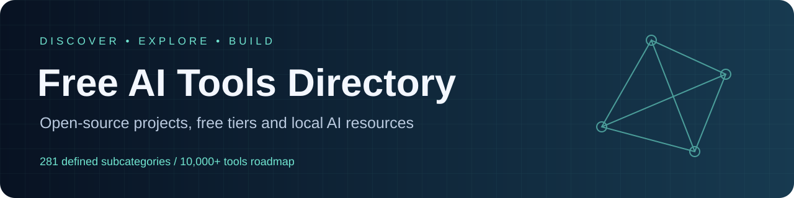

# Best Free AI Tools Directory

  
  
  
  
  
  
  
  
  

Discover AI image generators, video tools, coding assistants, AI agents, automation software, local AI models and open-source alternatives. Compare projects and check free access and licensing.

**[Explore the interactive directory](https://vaibcc.github.io/free-ai-tools-directory/)** · [Download full JSON catalog](data/tools.json) · [Suggest a project](https://github.com/vaibcc/free-ai-tools-directory/issues)

Catalog inclusion does not guarantee that a project is free, actively maintained or independently verified. Check licenses, free-plan limits and hosting requirements.

## Catalog overview

**31,733 listings · 18 populated categories**

| Category | Listings | Browse |
| --- | ---: | --- |
| AI agents | 2,669 | [View examples](#ai-agents) |
| AI security | 1,871 | [View examples](#ai-security) |
| Audio | 2,043 | [View examples](#audio) |
| Automation | 1,753 | [View examples](#automation) |
| Chat assistants | 609 | [View examples](#chat-assistants) |
| Coding | 2,775 | [View examples](#coding) |
| Data science | 2,298 | [View examples](#data-science) |
| Documents | 1,618 | [View examples](#documents) |
| Education | 708 | [View examples](#education) |
| Image | 2,311 | [View examples](#image) |
| Local AI | 2,736 | [View examples](#local-ai) |
| Multimodal | 1,724 | [View examples](#multimodal) |
| RAG and infrastructure | 2,623 | [View examples](#rag-and-infrastructure) |
| Research | 1,131 | [View examples](#research) |
| Robotics | 1,314 | [View examples](#robotics) |
| Search | 732 | [View examples](#search) |
| Translation | 1,257 | [View examples](#translation) |
| Video | 1,561 | [View examples](#video) |

## Category highlights

### AI agents

- [0-CODE](https://github.com/0-SOFT/0-CODE)
- [0KAY](https://github.com/RazureSOFT/0KAY)
- [0security](https://github.com/0sec-labs/0security)
- [0xClaw](https://github.com/0xclaw-ai/0xClaw)
- [100-AI-Agents-independent-projects](https://github.com/EimanTahir027/100-AI-Agents-independent-projects)
- [100x-engineer-skill](https://github.com/DeadInternetStudios/100x-engineer-skill)
- [10x](https://github.com/ntegrals/10x)
- [10xProductivity](https://github.com/ZhixiangLuo/10xProductivity)

[Browse all listings on the website](https://vaibcc.github.io/free-ai-tools-directory/)

### AI security

- [.context](https://github.com/forefy/.context)
- [0day-Rubbish](https://github.com/Exploit-Garbage/0day-Rubbish)
- [9router-pro](https://github.com/giienew/9router-pro)
- [a2a-demos](https://github.com/capiscio/a2a-demos)
- [A2SPA-Execution-Time-Authorization-for-Agentic-AI-Systems](https://github.com/devincapriola/A2SPA-Execution-Time-Authorization-for-Agentic-AI-Systems)
- [AATMF-Adversarial-AI-Threat-Modeling-Framework](https://github.com/SnailSploit/AATMF-Adversarial-AI-Threat-Modeling-Framework)
- [abeg-app](https://github.com/IfeOlulesi/abeg-app)
- [academic-students](https://github.com/Noam-Marom/academic-students)

[Browse all listings on the website](https://vaibcc.github.io/free-ai-tools-directory/)

### Audio

- [2ByteASR](https://github.com/NOTBAD314/2ByteASR)
- [A_chronology_of_deep_learning](https://github.com/Ravoxsg/A_chronology_of_deep_learning)
- [abogen](https://github.com/denizsafak/abogen)
- [AbstractMusic](https://github.com/lpalbou/AbstractMusic)
- [AceForge](https://github.com/audiohacking/AceForge)
- [acestep-action](https://github.com/audiohacking/acestep-action)
- [ACGTTS](https://github.com/chinoll/ACGTTS)
- [adapt](https://github.com/MycroftAI/adapt)

[Browse all listings on the website](https://vaibcc.github.io/free-ai-tools-directory/)

### Automation

- [-garighor-motors](https://github.com/IamRishiraj1/-garighor-motors)
- [.bitsandbrainsai](https://github.com/bitsandbrainsai/.bitsandbrainsai)
- [.github](https://github.com/DeepRank-AI/.github)
- [.github](https://github.com/intellwe/.github)
- [10-ai-social-content-factory](https://github.com/GeorgesMichalakis/10-ai-social-content-factory)
- [187WEB](https://github.com/LumenHelixLab/187WEB)
- [1ai-skills](https://github.com/oyi77/1ai-skills)
- [3kpro-website](https://github.com/3kpro/3kpro-website)

[Browse all listings on the website](https://vaibcc.github.io/free-ai-tools-directory/)

### Chat assistants

- [AChat](https://github.com/AprilNEA/AChat)
- [Activeloop-LangChain-CourseBot](https://github.com/ShruAgarwal/Activeloop-LangChain-CourseBot)
- [add-ons-samples](https://github.com/googleworkspace/add-ons-samples)
- [adrenaline](https://github.com/shobrook/adrenaline)
- [Adversarial-Learning-for-Neural-Dialogue-Generation-in-Tensorflow](https://github.com/liuyuemaicha/Adversarial-Learning-for-Neural-Dialogue-Generation-in-Tensorflow)
- [Aetherius_AI_Assistant](https://github.com/libraryofcelsus/Aetherius_AI_Assistant)
- [AetherLink](https://github.com/1600822305/AetherLink)
- [agent-craft](https://github.com/Annyfee/agent-craft)

[Browse all listings on the website](https://vaibcc.github.io/free-ai-tools-directory/)

### Coding

- [-Legacy-ai-session-governance](https://github.com/prompt-templates/-Legacy-ai-session-governance)
- [-work-journal-skill](https://github.com/Tk1777-sy/-work-journal-skill)
- [.claude](https://github.com/travisjneuman/.claude)
- [1000x-Agent-Skills](https://github.com/kunalsuri/1000x-Agent-Skills)
- [10x-Agent-Loop](https://github.com/XiaoLinXiaoZhu/10x-Agent-Loop)
- [10x-bench-kit](https://github.com/przeprogramowani/10x-bench-kit)
- [1c-ai-development-kit](https://github.com/Arman-Kudaibergenov/1c-ai-development-kit)
- [1c_http](https://github.com/ndSpacehead/1c_http)

[Browse all listings on the website](https://vaibcc.github.io/free-ai-tools-directory/)

### Data science

- [100-Days-Of-ML-Code](https://github.com/Avik-Jain/100-Days-Of-ML-Code)
- [100-Days-Of-ML-Code](https://github.com/MLEveryday/100-Days-Of-ML-Code)
- [2022L-WB-AutoML](https://github.com/mini-pw/2022L-WB-AutoML)
- [2027-AI-College-Jobs](https://github.com/speedyapply/2027-AI-College-Jobs)
- [3d-ken-burns](https://github.com/sniklaus/3d-ken-burns)
- [3D-Machine-Learning](https://github.com/timzhang642/3D-Machine-Learning)
- [3D-ResNets-PyTorch](https://github.com/kenshohara/3D-ResNets-PyTorch)
- [3DDFA](https://github.com/cleardusk/3DDFA)

[Browse all listings on the website](https://vaibcc.github.io/free-ai-tools-directory/)

### Documents

- [103Document-AI-From-OCR-to-Agentic-Doc-Extraction](https://github.com/linhongyu510/103Document-AI-From-OCR-to-Agentic-Doc-Extraction)
- [4399Register](https://github.com/boluoreg/4399Register)
- [Aadhaar-Card-OCR](https://github.com/dilippuri/Aadhaar-Card-OCR)
- [Aadhaar-UID-Masking-Tool](https://github.com/Devansh80/Aadhaar-UID-Masking-Tool)
- [academi_slide](https://github.com/nicolaslpf/academi_slide)
- [Academical-Paper-Converter-To-Epub](https://github.com/enderonat/Academical-Paper-Converter-To-Epub)
- [acrobat-pro-benomir-pdf-workspace](https://github.com/Nkyoko109/acrobat-pro-benomir-pdf-workspace)
- [acrobat-pro-ranomar-pdf-workspace](https://github.com/Atrophys/acrobat-pro-ranomar-pdf-workspace)

[Browse all listings on the website](https://vaibcc.github.io/free-ai-tools-directory/)

### Education

- [01player-earth-survival-guide](https://github.com/XiaoSiKe/01player-earth-survival-guide)
- [11408Advance-mcp](https://github.com/hanserdesu/11408Advance-mcp)
- [121-tutor](https://github.com/Deepender25/121-tutor)
- [academy-cockpit](https://github.com/C-Moir/academy-cockpit)
- [Acadex-AI-Google-Deepmind](https://github.com/addy100/Acadex-AI-Google-Deepmind)
- [aceL---AI-learning-platform](https://github.com/IsaacChen89/aceL---AI-learning-platform)
- [actife](https://github.com/rhaffle87/actife)
- [Adaptation-Teaching](https://github.com/MonsieurNikko/Adaptation-Teaching)

[Browse all listings on the website](https://vaibcc.github.io/free-ai-tools-directory/)

### Image

- [365-skills](https://github.com/Agents365-ai/365-skills)
- [3DEnhancer](https://github.com/Luo-Yihang/3DEnhancer)
- [4k-video-upscaler-colab](https://github.com/yuvraj108c/4k-video-upscaler-colab)
- [4x-Upscaler-ESRGAN](https://github.com/aidendorian/4x-Upscaler-ESRGAN)
- [A-list-of-retinal-image-enhancement-papers](https://github.com/ShuheZhang-MUMC/A-list-of-retinal-image-enhancement-papers)
- [a-person-mask-generator](https://github.com/djbielejeski/a-person-mask-generator)
- [a1111-mini-paint](https://github.com/0Tick/a1111-mini-paint)
- [A3D](https://github.com/n0neye/A3D)

[Browse all listings on the website](https://vaibcc.github.io/free-ai-tools-directory/)

### Local AI

- [12_taxobservatory](https://github.com/dataforgoodfr/12_taxobservatory)
- [1667](https://github.com/1667-ai/1667)
- [1Panel](https://github.com/1Panel-dev/1Panel)
- [4x3090-llm-benchmarks](https://github.com/alesha-pro/4x3090-llm-benchmarks)
- [4xV100-qwen38-flash-next-abliterated-128gb-vram](https://github.com/Redhatvale/4xV100-qwen38-flash-next-abliterated-128gb-vram)
- [9router-auto-free](https://github.com/herliansyah/9router-auto-free)
- [_y](https://github.com/antryu2b/_y)
- [a-collection-of-tweaks-and-notes-from-my-cachyos-journey](https://github.com/NishantJLU/a-collection-of-tweaks-and-notes-from-my-cachyos-journey)

[Browse all listings on the website](https://vaibcc.github.io/free-ai-tools-directory/)

### Multimodal

- [-OpenEyes-Live](https://github.com/vfvincentwong2026/-OpenEyes-Live)
- [A2Summ](https://github.com/boheumd/A2Summ)
- [AAPL](https://github.com/Gahyeonkim09/AAPL)
- [ACCIDENT-CVPR-2026](https://github.com/Amey-Thakur/ACCIDENT-CVPR-2026)
- [ACE-LoRA](https://github.com/icon-lab/ACE-LoRA)
- [achatbot](https://github.com/ai-bot-pro/achatbot)
- [ActionEQA_TMLR_2026](https://github.com/ActionEQA/ActionEQA_TMLR_2026)
- [AdaptVision](https://github.com/AdaptVision/AdaptVision)

[Browse all listings on the website](https://vaibcc.github.io/free-ai-tools-directory/)

### RAG and infrastructure

- [.github](https://github.com/openlit/.github)
- [0gmem](https://github.com/loganionian/0gmem)
- [2025-ironman-llmops](https://github.com/hazel-shen/2025-ironman-llmops)
- [3GPP-Everything](https://github.com/EpisodeYu/3GPP-Everything)
- [7-docs](https://github.com/7-docs/7-docs)
- [9routerx](https://github.com/yanstd888/9routerx)
- [A-Guide-to-Retrieval-Augmented-LLM](https://github.com/Wang-Shuo/A-Guide-to-Retrieval-Augmented-LLM)
- [a-mem-mcp-server](https://github.com/tobs-code/a-mem-mcp-server)

[Browse all listings on the website](https://vaibcc.github.io/free-ai-tools-directory/)

### Research

- [.github](https://github.com/compassionate-ai-lab/.github)
- [18S096SciML](https://github.com/mitmath/18S096SciML)
- [A-Preamble-to-Automated-Intelligence-Authorization-Topology-and-Identity-Continuity](https://github.com/michaeljb79-ai/A-Preamble-to-Automated-Intelligence-Authorization-Topology-and-Identity-Continuity)
- [aa_autoencoder_mca](https://github.com/erdc/aa_autoencoder_mca)
- [AAA](https://github.com/Cinqic-Research/AAA)
- [academic-research-skills](https://github.com/Imbad0202/academic-research-skills)
- [academic-research-skills-codex](https://github.com/Imbad0202/academic-research-skills-codex)
- [academic-scientific-skill](https://github.com/H66e/academic-scientific-skill)

[Browse all listings on the website](https://vaibcc.github.io/free-ai-tools-directory/)

### Robotics

- [.github](https://github.com/openAMRobot/.github)
- [.github](https://github.com/Runix-lab/.github)
- [1000-Segments-6-camera-Egocentric-Embodied-AI-Dataset](https://github.com/Nexdata-AI/1000-Segments-6-camera-Egocentric-Embodied-AI-Dataset)
- [20-watts-was-enough](https://github.com/tekmora/20-watts-was-enough)
- [2025-tactile-whisking](https://github.com/neuroagents-lab/2025-tactile-whisking)
- [3D-CovDiffusion](https://github.com/crystalccy1/3D-CovDiffusion)
- [3D-Mem](https://github.com/UMass-Embodied-AGI/3D-Mem)
- [3d-world-model-guide](https://github.com/IDAdu/3d-world-model-guide)

[Browse all listings on the website](https://vaibcc.github.io/free-ai-tools-directory/)

### Search

- [1c-ai-dev-env](https://github.com/Pradushkoai/1c-ai-dev-env)
- [1c-templates-mcp](https://github.com/Desko77/1c-templates-mcp)
- [abstracts-search](https://github.com/colonelwatch/abstracts-search)
- [ace-mcp-go](https://github.com/xiaoxu123195/ace-mcp-go)
- [Ace-Mcp-Node](https://github.com/yeuxuan/Ace-Mcp-Node)
- [ace-playbook](https://github.com/jmanhype/ace-playbook)
- [action-hub-updater](https://github.com/jina-ai/action-hub-updater)
- [adk-redis](https://github.com/redis-developer/adk-redis)

[Browse all listings on the website](https://vaibcc.github.io/free-ai-tools-directory/)

### Translation

- [006-many-to-eng](https://github.com/thammegowda/006-many-to-eng)
- [100daysofML](https://github.com/prabhupad26/100daysofML)
- [2018-dlsl](https://github.com/telecombcn-dl/2018-dlsl)
- [212-Hours-Burmese-Spontaneous-Speech-Data](https://github.com/Nexdata-AI/212-Hours-Burmese-Spontaneous-Speech-Data)
- [3AM](https://github.com/MaxyLee/3AM)
- [7290000-Groups--Chinese--Vietnamese-Parallel-Corpus-Data](https://github.com/Nexdata-AI/7290000-Groups--Chinese--Vietnamese-Parallel-Corpus-Data)
- [aaron-project-hppr](https://github.com/aaronlifenghan/aaron-project-hppr)
- [aaron-project-lepor](https://github.com/aaronlifenghan/aaron-project-lepor)

[Browse all listings on the website](https://vaibcc.github.io/free-ai-tools-directory/)

### Video

- [-h3-8gb-traps](https://github.com/FlowForgeLabAi/-h3-8gb-traps)
- [.github](https://github.com/zsky-ai/.github)
- [.github](https://github.com/aivideoweb/.github)
- [30x-video](https://github.com/norahe0304-art/30x-video)
- [3d-filmmaking-ads-multimodal-evals](https://github.com/jameswniu/3d-filmmaking-ads-multimodal-evals)
- [4DAnyone](https://github.com/ant-research/4DAnyone)
- [53on-ai-server](https://github.com/53on/53on-ai-server)
- [AAAI2024-CPABMM](https://github.com/whx-sjtu/AAAI2024-CPABMM)

[Browse all listings on the website](https://vaibcc.github.io/free-ai-tools-directory/)

## Contributing

Suggest additions or corrections through GitHub Issues. The catalog and this overview are refreshed automatically.
